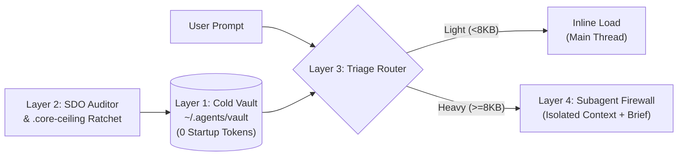

# 💎 PRISM — Progressive Routing, Indexing & Skill Manager

<p align="center">
  <strong>One beam in. Exact specialist skill out. Zero startup token bloat.</strong><br/>
  <em>The 4-Layer Ultra-Pattern Skill Architecture for Google Antigravity, Claude Code, OpenAI Codex, Cursor & Windsurf.</em>
</p>

<p align="center">
  
  
  
  
</p>

---

## 🚨 The Problem: Why "Agent Skills" Break at Scale

**Agent Skills (`SKILL.md`)** are one of the greatest breakthroughs in Agentic AI. Instead of stuffing every workflow into a monolithic `CLAUDE.md`, `AGENTS.md`, or `GEMINI.md` file, skills use **Progressive Disclosure (Lazy Loading)**:
1. **Discovery (Startup):** The agent loads *only* the YAML frontmatter (`name` and `description`) of each skill into the system prompt.
2. **Activation (On-Demand):** The agent reads the full `SKILL.md` body *only* when your prompt matches that description.
3. **Deep Reference (Just-in-Time):** The agent reads helper files in `references/` or runs `scripts/` *only* when a specific sub-step requires them.

**That works beautifully when you have 5 skills. It collapses when you collect 50 to 300+ skills.**

As power users and engineering teams scale their skill libraries across **Google Antigravity, Claude Code, and OpenAI Codex**, they hit **five silent architectural walls**:

### 1. The Startup Token Tax ("Description Bloat")
Because the `name` and `description` of **every active global skill** are injected into **every single chat thread**, collecting 60 skills with verbose 120-word descriptions burns **7,000 to 15,000 tokens** on every conversation before you even type `"hello"`. Worse, many platforms enforce hard truncation caps (silently dropping skills past ~30–40 entries or `1,024` characters).

### 2. The SDO "Workflow Shortcut" Bug
Empirical agent testing (originally uncovered in [`obra/superpowers`](https://github.com/obra/superpowers)) revealed a counter-intuitive failure mode:
> **When a skill's `description:` summarizes *how* the workflow operates, the LLM treats the description as a TL;DR shortcut and skips reading the `SKILL.md` file entirely!**

For example, a skill whose description said *"dispatches subagent per task with code review between tasks"* caused the agent to perform only one superficial review instead of reading the two-stage review flowchart inside `SKILL.md`. Removing the workflow summary and changing the description to *"Use when executing implementation plans with independent tasks"* immediately restored 100% compliance.

### 3. The 20,000-Byte Compaction Cliff
When long coding sessions hit context compaction, agent harnesses re-attach invoked skills **truncated at 20,000 characters**. If your `SKILL.md` is `28 KB`, the bottom `8 KB` of rules and edge cases are silently amputated mid-session without warning.

### 4. Semantic Trigger Collisions
When 50 flat skills live in `~/.claude/skills/` or `~/.gemini/config/skills/` with overlapping buzzwords (*"react"*, *"frontend"*, *"video"*, *"animation"*, *"architecture"*), the model suffers routing paralysis—activating the wrong skill or hallucinating blended rules.

### 5. The "Prose Diet" Fallacy (Why Guidelines Fail Without a Ratchet)
Telling contributors *"keep `SKILL.md` concise"* always loses to 100 individually reasonable additions over time. Without a mechanical **one-way ceiling ratchet** (pioneered by [`rebelytics/one-skill-to-rule-them-all`](https://github.com/rebelytics/one-skill-to-rule-them-all)), every trimmed skill eventually re-bloats.

---

## 💡 The Breakthrough: PRISM's 4-Layer Ultra-Pattern Architecture

Previously, engineers tried solving these problems with isolated tools—either a symlink package manager, a hook-based router, a markdown index table, or a static validator. Stacking those tools naively causes **double-hop routing overhead** (where a hook injects a skill, and the agent still wastes tool calls reading an index table).

**PRISM** unifies the four proven anti-bloat engineering patterns into **four non-overlapping layers**:

```text
User Prompt Arrives
        │
        ▼
┌────────────────────────────────────────────────────────────────────────────┐
│ LAYER 1: Cold Vault & Active Tiering (vault_manager.py)                    │
│  • Tier 0 (Global Active): Max 5–7 daily universal skills                  │
│  • Tier 1 (Workspace Symlink): Repo-specific skills in .agents/skills/     │
│  • Tier 2 (Cold Vault): 500+ specialist skills in ~/.agents/vault (0 tax!) │
└──────────────────────────────────────┬─────────────────────────────────────┘
                                       │
                                       ▼
┌────────────────────────────────────────────────────────────────────────────┐
│ LAYER 2: SDO Hygiene & One-Way Core-Size Ratchet (audit_skills.py)         │
│  • Enforces "Use when..." trigger-only descriptions (<350 chars)           │
│  • Blocks the 20,000-byte Compaction Cliff & @path force-load leaks        │
│  • Locks line counts via .core-ceiling & references/ceilings.txt           │
│  • Detects pairwise Semantic Trigger Collisions via TF-IDF overlap         │
└──────────────────────────────────────┬─────────────────────────────────────┘
                                       │
                                       ▼
┌────────────────────────────────────────────────────────────────────────────┐
│ LAYER 3: Hybrid Dual-Leg Triage Router (build_index.py + route_task.py)    │
│  • Portable Mode (Default): <1,000 token Hub Table (references/_INDEX.md)  │
│  • Hook Mode (Optional): <50ms PreInvocation / UserPromptSubmit injection  │
│  • Pairs Leg 1 (Domain Skill) + Leg 2 (Process Skill, e.g. TDD/Debugging)  │
└──────────────────────────────────────┬─────────────────────────────────────┘
                                       │
                                       ▼
┌────────────────────────────────────────────────────────────────────────────┐
│ LAYER 4: Subagent Context Firewall (invoke_subagent / Task)                │
│  • INLINE (<8 KB total package): Read SKILL.md directly in main thread     │
│  • SUBAGENT_FIREWALL (>=8 KB or audit): Delegate via pre-built Subagent    │
│    Brief so 100 KB+ reference manuals never pollute main chat history!     │
└────────────────────────────────────────────────────────────────────────────┘
```



---

## 📊 Real-World Benchmark: Before vs. After PRISM

Measured on a real production developer machine with **55 installed skill directories** across Antigravity, Claude Code, and OpenAI Codex:

| Metric | Unmanaged Flat Skills (Before) | With PRISM 4-Layer Architecture | Impact |
| :--- | :--- | :--- | :--- |
| **Global Startup Token Tax** | `6,527 tokens` on every turn | **`~320 tokens`** (`prism` + 5 core skills) | **95% reduction in idle context** |
| **Vaulted Skills Capacity** | Drops/truncates past ~40 skills | **500+ skills** in `~/.agents/vault` | **0 startup tokens** for vaulted skills |
| **Hub Index Footprint (`_INDEX.md`)** | N/A (all frontmatter raw-loaded) | **`~920 tokens`** for 52 unique skills | Fits 50+ skills in `<1,000 tokens` |
| **Skills Over 20 KB Compaction Cliff** | 6 skills silently truncated mid-chat | **0** (caught & split by `audit_skills.py`) | **100% compaction survival** |
| **Main-Thread Pollution on Heavy Skills** | `30 KB – 150 KB` dumped into main chat | **Isolated in Subagent (`~200 token` summary)** | **50x–100x main-thread token savings** |

---

## ⚡ Quick Start & Installation

**PRISM** uses **100% standard library Python 3** (zero `pip` or `npm` dependencies required).

### 1. Clone & Install Across Your Harnesses
```bash
git clone https://github.com/lmsutools/prism-progressive-routing-indexing-skill-manager.git ~/.agents/prism
cd ~/.agents/prism
bash install.sh
```
*(Or symlink manually into `~/.gemini/config/skills/prism`, `~/.claude/skills/prism`, or `~/.codex/skills/prism`).*

### 2. Run a Forensic Audit of All Installed Skills
Scan every skill across **Antigravity, Claude Code, Codex, `.agents/skills`, and your Cold Vault**:
```bash
python3 scripts/prism.py audit
```
**What `prism.py audit` checks on every skill:**
- ✅ **Startup Token Tax:** Exact token cost injected into every chat thread.
- ✅ **SDO Frontmatter Gate:** Flags descriptions that don't start with `"Use when..."`, exceed `350–500 chars`, or contain workflow-summary shortcuts—and **auto-generates a suggested SDO rewrite**!
- ✅ **20,000-Byte Compaction Cliff:** Flags any `SKILL.md` approaching or exceeding `20 KB`.
- ✅ **Static Link & Residue Gate:** Verifies every relative `references/*`, `scripts/*`, `resources/*`, and `assets/*` path cited in `SKILL.md` actually exists on disk, and blocks `@path` force-loads or merge residue.
- ✅ **One-Way Core-Size Ratchet:** Enforces `.core-ceiling` and `references/ceilings.txt` so trimmed files can never silently re-bloat.
- ✅ **Semantic Collision Detector:** Flags pairs of skills with `>= 32%` trigger keyword overlap.

### 3. Park Specialized Skills in the Cold Vault (Zero Startup Cost)
Move rarely used or heavy domain skills out of global startup discovery into `~/.agents/vault/`:
```bash
# View all skills across Antigravity, Claude, Codex, Workspace, and Cold Vault
python3 scripts/prism.py vault status

# Park a skill in the Cold Vault (drops its startup token tax to 0 while keeping it routable!)
python3 scripts/prism.py vault park <skill-name>

# Activate (symlink) a vaulted skill into the current project workspace (.agents/skills/) or a specific IDE
python3 scripts/prism.py vault activate <skill-name> --target workspace
```

### 4. Build the Shadow Index & Route Tasks
```bash
# Rebuild ~/.agents/prism_index.json and references/_INDEX.md (<1,000 tokens)
python3 scripts/prism.py index

# Route any prompt to a Domain Skill + Process Skill + Subagent Firewall Brief
python3 scripts/prism.py route "diagnose slow cargo compile times in my multi-crate rust workspace"
```
Example output:
```text
[PRISM Route Card] Matched `weedo-rust-dev-skill` (score=14.95, tier=tier0_global, evidence=rust,cargo,compile)
▶ Domain/Primary Skill: `weedo-rust-dev-skill` → Read `/Users/you/.gemini/config/skills/weedo-rust-dev-skill/SKILL.md`
🛡️ Subagent Firewall Recommended (123.1KB total package): For deep audits or multi-step execution, delegate via `invoke_subagent` with brief: "Read and follow `.../SKILL.md` to execute this task. Only load files inside its `references/` folder that match the specific workflow step. Return a concise summary of actions, findings, and verification results."
```

### 5. Optional: Enable `<50ms` Auto-Routing Lifecycle Hooks
Want route cards injected automatically before the model's turn without lifting a finger? Generate the native hook configuration for **Antigravity** (`PreInvocation` ephemeral message) or **Claude Code** (`UserPromptSubmit`):
```bash
# For Google Antigravity (~/.gemini/config/hooks.json or .agents/hooks.json)
python3 scripts/prism.py hooks --harness antigravity

# For Claude Code (~/.claude/settings.json)
python3 scripts/prism.py hooks --harness claude
```

---

## 🗂️ Repository Structure

```text
prism/
├── SKILL.md                          # SDO-compliant core skill (100/100 score, locked at 93 lines)
├── .core-ceiling                     # One-way downward line ratchet for SKILL.md
├── install.sh                        # Cross-harness symlink installer + initial index builder
├── scripts/
│   ├── prism.py                      # Unified CLI dispatcher (audit | index | vault | route | hooks)
│   ├── audit_skills.py               # Layer 2: SDO auditor, 20KB cliff gate, link checker, collision detector
│   ├── build_index.py                # Layer 1 & 3: SHA1 shadow indexer + <1,000 token _INDEX.md builder
│   ├── vault_manager.py              # Layer 1: Cold Vault (~/.agents/vault) & multi-IDE symlink manager
│   └── route_task.py                 # Layer 3 & 4: Dual-leg TF-IDF router, Subagent Firewall & Hook emitter
├── references/
│   ├── _INDEX.md                     # Compact Hub-and-Spoke routing table (<1,000 tokens)
│   ├── ultra-architecture.md         # Deep reference on the 4-Layer Ultra-Pattern Architecture
│   ├── sdo-refactoring-guide.md      # Positive recipes for de-bloating descriptions & splitting >20KB skills
│   ├── hook-integration.md           # Setup guide for Antigravity & Claude Code lifecycle hooks
│   └── ceilings.txt                  # Locked line ceilings for all reference files
└── tests/
    └── test_prism.py                 # Automated self-test suite (dogfoods PRISM's own 100/100 compliance)
```

---

## 🙏 Acknowledgments & Prior Art

PRISM stands on the shoulders of the pioneers who discovered and documented the scaling laws of Agent Skills:
- **[`obra/superpowers`](https://github.com/obra/superpowers)** (Jesse Vincent) — For discovering the SDO/CSO "Workflow Summary Shortcut" bug, the `20,000-byte` compaction truncation test, and TDD for process documentation.
- **[`hussi9/skill-router`](https://github.com/hussi9/skill-router)** — For pioneering non-destructive shadow indexing (`skill_index.json`), weighted `use_when` + TF-IDF ranking, Dual-Leg (`Domain + Process`) routing chains, and Subagent route propagation.
- **[`rebelytics/one-skill-to-rule-them-all`](https://github.com/rebelytics/one-skill-to-rule-them-all)** (Eoghan Henn) — For inventing the one-way **Core-Size Ratchet** (`.core-ceiling` & `ceilings.txt`), static relative-path verification, and edit-residue gates.
- **[`pcx-wave/skill-router`](https://github.com/pcx-wave/skill-router)** — For demonstrating the `<1,000 token` compact in-session index table and fast-exit conversational gate.
- **[`lijianru/skills-manager`](https://github.com/lijianru/skills-manager)** (`skm`) — For multi-IDE symlink distribution across Antigravity, Claude Code, Codex, Cursor, and Windsurf.

---

## 📄 License

Released under the [MIT License](LICENSE).
